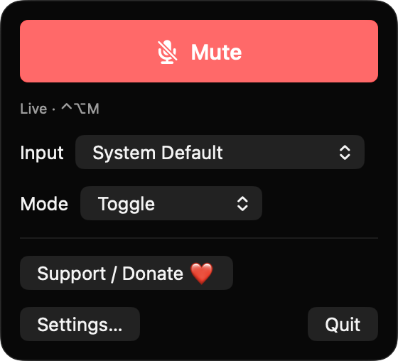
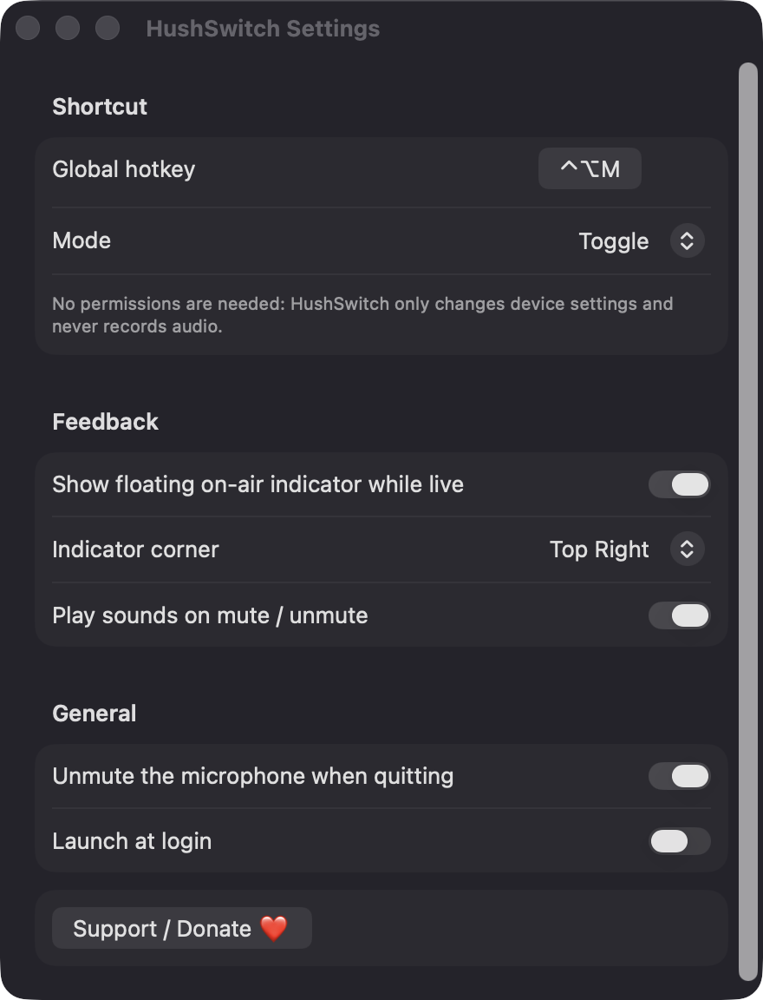
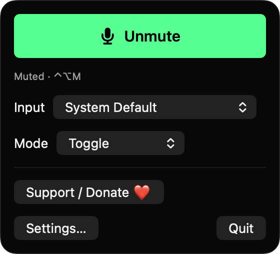

# HushSwitch

**🌐 Website:** [turhe123.github.io/hush-switch](https://turhe123.github.io/hush-switch/)

One global hotkey to mute or unmute your microphone in any app, with push-to-talk and an on-air indicator.

> 🆓 A free, open-source **Mic Drop alternative** for macOS 14+. Native Swift, no accounts, no subscriptions, MIT licensed.

> 🆓 A free, open-source **Mic Drop alternative** for macOS 14+. Native Swift, no accounts, no subscriptions, MIT licensed.


## Why

HushSwitch is a free, open-source, 100% native, backend-free alternative to paid utilities in the *Audio* category. It was inspired by Mic Drop ($5 one-time), a fine app that proved how much a single mute shortcut helps on calls. HushSwitch is a clean-room implementation: it uses only Apple frameworks, has no servers, no accounts and no analytics.

## Features

- **Global hotkey** (default `⌃⌥M`), registered with Carbon `RegisterEventHotKey`. Record any combination in Settings.
- **Three modes:** Toggle, Push to Talk (muted until the key is held) and Push to Mute (live until the key is held).
- **Menu bar icon** that shows state at a glance: a regular mic when live, a red slashed mic when muted.
- **Menu bar panel** with a large Mute/Unmute button, an input device picker and a mode picker.
- **Choose the device** to control: follow the System Default input or pick a specific one. If the chosen device disappears, HushSwitch falls back to the default input and tells you.
- **Mute state follows reality:** CoreAudio property listeners keep the icon correct even if another app changes the mute or volume.
- **Volume fallback:** if a device has no system mute control, HushSwitch drops its input volume to zero and restores the stored volume on unmute. Devices with neither control are flagged as unmutable.
- **Mute state is carried over** when you switch devices.
- **Floating "ON AIR" pill** shown only while the mic is live. It is click-through, appears on all Spaces, and can sit in any screen corner.
- **Optional sound cues** on mute and unmute.
- **Hotkey conflict detection:** shortcuts used by macOS or by another app show an error in the recorder.
- **Robust push-to-talk:** key auto-repeat is ignored, and after the Mac wakes from sleep the mode's resting state is re-applied in case a key-up was lost.
- **Unmute on quit** (on by default, can be turned off).
- **Launch at login** via `SMAppService`.
- **Empty state** when no microphone is connected.

## Screenshots

<p align="center"></p>

<p align="center"><em>The menu bar panel with a big Mute button, the current hotkey, and pickers for the input device and mode.</em></p>

<p align="center"></p>

<p align="center"><em>Settings for the global hotkey, mode, on-air indicator, sound cues, unmute on quit and launch at login.</em></p>

<p align="center"></p>

<p align="center"><em>When the mic is muted, the panel switches to a green Unmute button and shows the Muted status.</em></p>

## Install

1. Download `HushSwitch-macOS.zip` from the [latest release](https://github.com/turhe123/hush-switch/releases/latest).
2. Unzip it and move `HushSwitch.app` to `/Applications`.
3. Because the app is open source and not notarized, clear the quarantine flag:

   ```bash
   xattr -cr /Applications/HushSwitch.app
   ```

4. Right-click the app → **Open** the first time.

Requires macOS 14.0 or later. HushSwitch lives in the menu bar and has no Dock icon.

## Build from source

```bash
brew install xcodegen
xcodegen generate
xcodebuild -project HushSwitch.xcodeproj -scheme HushSwitch -configuration Release -derivedDataPath ./build build
```

The app is produced at `build/Build/Products/Release/HushSwitch.app`.

## Permissions

HushSwitch needs **no special permissions**:

- **Accessibility:** not required. The global hotkey uses Carbon `RegisterEventHotKey`, which needs no permission.
- **Screen Recording:** not required. The on-air pill is an ordinary window the app draws itself.
- **Microphone:** not required. The app never records or reads audio. It only reads and writes device properties (mute and input volume) through CoreAudio.

The only system interaction is the optional **Launch at login** toggle, which registers a login item. You can review it in System Settings › General › Login Items.

## Built with AI

HushSwitch was written by [Claude Code](https://claude.com/claude-code) inside an automated pipeline, from a plain-English spec. No code, binaries or assets from any commercial app were used; it is a clean-room reimplementation of a feature set, not a copy.

What that means in practice:

- The full source is in this repo under the MIT license. Read it before you run it.
- No network calls, no analytics, no third-party dependencies. Only Apple frameworks.
- Ad-hoc signed and not notarized, which is why Gatekeeper warns on first launch.
- It has had less human review than a hand-written app. Bug reports and pull requests are welcome.

## Support ❤️

If HushSwitch saves you from an embarrassing unmuted moment, you can support development:

[Support Or (Leo) Davidai ❤️](https://ko-fi.com/leodavidai)

## More free Mac apps

HushSwitch is one of [60 free, open-source Mac utilities](https://github.com/turhe123/mac-apps) built the same way: native Swift, no accounts, no telemetry. Browse the full gallery at [turhe123.github.io/mac-apps](https://turhe123.github.io/mac-apps/).

## License

MIT © Or Davidai Bachar
